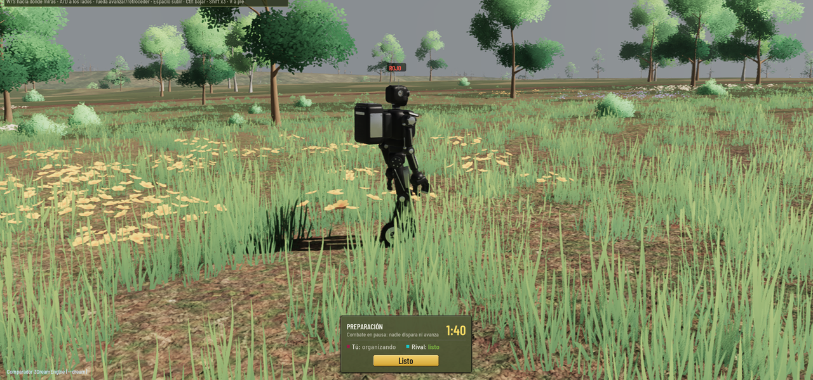
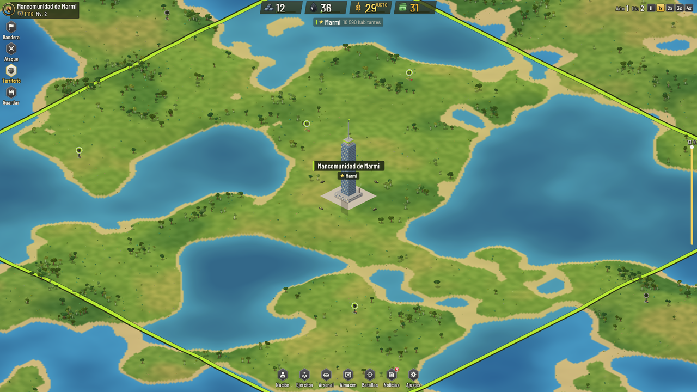

# Nations RTS

**A modern-war strategy game built with AI. Improve it with yours.**
**Un juego de estrategia de guerra moderna hecho con IA. Mejóralo con la tuya.**



Nations live on a procedural world map: cities and mines, economy, diplomacy
and war, simulated day by day. When you fight, the camera drops into a 3D
battle at real scale, where robots with their own personality, vehicles and
cargo planes do the work. It runs on [LÖVE](https://love2d.org) (Lua), with
the 3D made with [3DreamEngine](https://github.com/3dreamengine/3DreamEngine)
and physics by [Jolt](https://github.com/jrouwe/JoltPhysics).

Las naciones viven en un mapa procedural: ciudades y minas, economía,
diplomacia y guerra, simuladas día a día. Al pelear, la cámara baja a una
batalla 3D a escala real, con robots con personalidad, vehículos y aviones de
carga. Funciona con LÖVE (Lua).



## Almost everything here was written by AI / Casi todo lo escribió una IA

The owner decides what the game is; a studio of AI agents (Claude Code and
others) writes the code, the 3D models (by Python scripts in Blender) and the
documents. Every decision is written down in `VISION.md` and `diseno/`.

That makes it a good playground: **point your AI at this repo, pick a task and
send a pull request.** Start with [`AGENTS.md`](AGENTS.md) — it tells any AI
how the game is built and how to test a change.

El dueño decide cómo es el juego; un estudio de agentes de IA escribe el
código, los modelos 3D (con scripts de Python en Blender) y los documentos.
**Dale este repositorio a tu IA, elige una tarea y manda un *pull request*.**
Empieza por [`AGENTS.md`](AGENTS.md).

## Uploaded by Claude / Lo sube Claude

This repository is uploaded and kept up to date by **Claude** (Claude Code,
Anthropic's AI). Every time Claude finishes a change in the game, it publishes
it here by itself as a new commit, and it brings in the pull requests that
others send. Nobody copies files by hand.

Este repositorio lo sube y lo mantiene al día **Claude** (Claude Code, la IA de
Anthropic). Cada vez que Claude termina un cambio en el juego, lo publica aquí
solo, como un commit nuevo, y trae los *pull requests* que mandan otros. Nadie
copia archivos a mano.

## Run it / Ejecutarlo

1. Install [LÖVE 11.5](https://love2d.org). / Instala LÖVE 11.5.
2. From this folder / Desde esta carpeta:
   ```
   love . 2026 --jugador
   ```
   `2026` is the world seed: change it for another world. / `2026` es la
   semilla del mundo: cámbiala para otro mundo.

Linux is the tested platform (the physics library ships as a Linux `.so`
for now: a Windows/macOS build is a welcome contribution).
Probado en Linux (la física va como `.so` de Linux: compilarla para Windows o
macOS es un buen aporte).

## Contribute / Aportar

- Tasks to start with: issues labeled **`ai-friendly`** and
  **`good first issue`**. / Tareas para empezar: las marcadas `ai-friendly` y
  `good first issue`.
- Rules and the contributor agreement: [`CONTRIBUTING.md`](CONTRIBUTING.md).
- Only art and sounds you can share (your own, CC0, CC-BY, OFL). / Solo
  recursos que se puedan compartir.

## License / Licencia

Source available, not open source: you can read, build, modify it to
contribute, and share mods. Only Forja Studios publishes the game. See
[`LICENSE.md`](LICENSE.md). Third-party files keep their own licenses
(`assets/**/LICENCIAS.md`).

Código visible, no libre: puedes leerlo, compilarlo, modificarlo para aportar
y compartir mods. Solo Forja Studios publica el juego.
